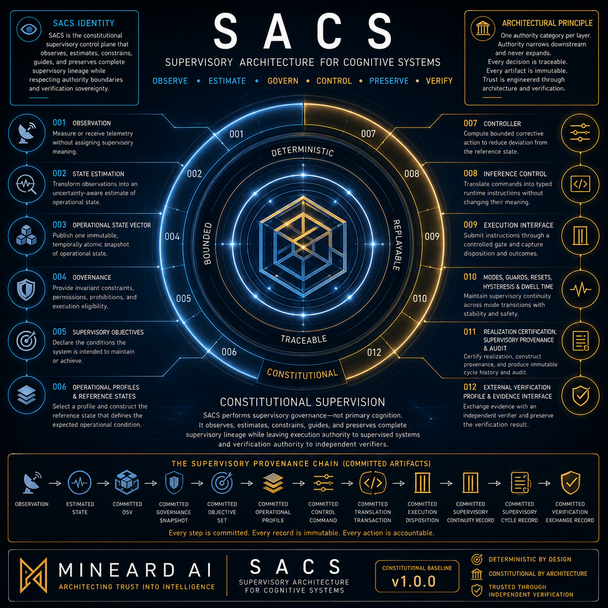

# SACS — Supervisory Architecture for Cognitive Systems



SACS is a deterministic, constitutional supervisory architecture for cognitive, generative, agentic, and adaptive systems. It defines contract-owned authority boundaries, processes committed artifacts, preserves supervisory provenance, and provides a bounded interface for external verification.

SACS supervises systems; it is not the model, agent, provider runtime, or primary-work execution environment.

## What SACS does

SACS provides an explicit supervisory path for:

- observing operational state;
- estimating supervisory state;
- applying governance constraints;
- evaluating supervisory objectives;
- activating operational profiles and reference states;
- computing bounded supervisory control;
- translating committed supervisory intent;
- preserving deterministic provenance and replay evidence; and
- exposing a defined boundary for external verification.

Committed artifacts are the only authoritative downstream inputs. Authority may narrow downstream, but it may not broaden. Construction is not commitment; validation is not certification; certification is not execution; and execution is not history.

## What SACS does not do

SACS does not generate primary AI content, replace foundation models, host provider runtimes, invent governance, redefine supervised systems, or perform external verification. It does not broaden constitutional authority or claim production deployment readiness, accreditation, certification, or external assurance.

## Architecture overview

```text
Observation
      ↓
State Estimation
      ↓
Operational State Vector
      ↓
Governance
      ↓
Supervisory Objectives
      ↓
Operational Profiles
      ↓
Controller
      ↓
Inference Control
      ↓
Execution Interface
      ↓
Supervisory Continuity and History
      ↓
External Verification Boundary
```

Contract 012 is the terminal contract in the v1.0.0 core. Institutional learning, constitutional evolution, and successor contracts are outside that core.

## Core design principles

- deterministic behavior and replayability;
- explicit authority ownership and commitment boundaries;
- immutable canonical artifacts;
- supervisory provenance and auditability;
- traceable contract-to-implementation relationships; and
- separation between constitutional authority and implementation realization.

## Repository layout

- `contracts/` — Contracts 000–012 and their normative source corpus.
- `source-pack/` — subordinate constitutional-supporting guidance.
- `implementation/` — bounded Rust workspace and reference realization.
- `implementation/docs/` — implementation profiles, source matrices, and status records.
- `implementation/evidence/` — conformance-vector and evidence indexes.
- `docs/` — public release-integrity documentation and repository assets.

## Relationship to the Mineard AI ecosystem

SACS is a supervisory component of the broader Mineard AI ecosystem. It supervises other systems through explicit interfaces and contract-defined boundaries without owning their internal models, provider authority, or primary-work semantics.

## Quick start

From the repository root:

```text
cargo fmt --manifest-path implementation/Cargo.toml --all -- --check
cargo test --manifest-path implementation/Cargo.toml --workspace
cargo clippy --manifest-path implementation/Cargo.toml --workspace --all-targets -- -D warnings
cargo metadata --manifest-path implementation/Cargo.toml --no-deps
```

The checked public tree contains a bounded reference realization. It is not a production runtime or deployment package.

## Documentation

- [Constitutional Baseline](SACS_CONSTITUTIONAL_BASELINE_v1.0.0.md)
- [Implementation Baseline](SACS_IMPLEMENTATION_BASELINE_v1.0.0.md)
- [Contracts](contracts/)
- [Source Pack](source-pack/SACS_SOURCE_PACK_INDEX.md)
- [Implementation profile](implementation/docs/IMPLEMENTATION_PROFILE.md)
- [Evidence index](implementation/evidence/EVIDENCE_INDEX.md)
- [Public Release Integrity](docs/PUBLIC_RELEASE_INTEGRITY.md)

## Contributing and security

See [CONTRIBUTING.md](CONTRIBUTING.md) for contribution boundaries and [SECURITY.md](SECURITY.md) for vulnerability-reporting guidance.

## License

SACS is released under the Apache License 2.0. See [LICENSE](LICENSE) and [NOTICE](NOTICE).
